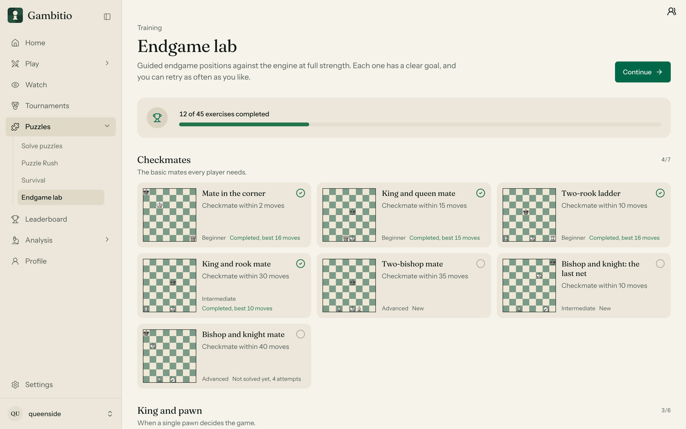
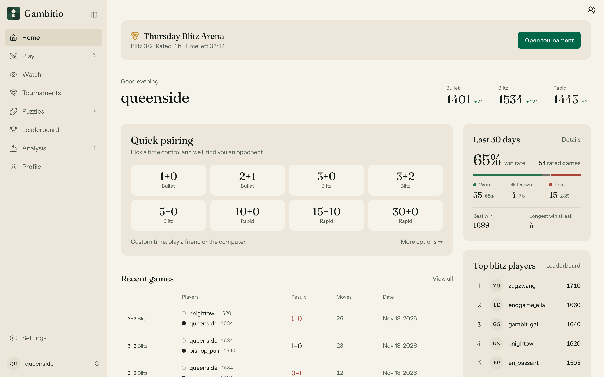
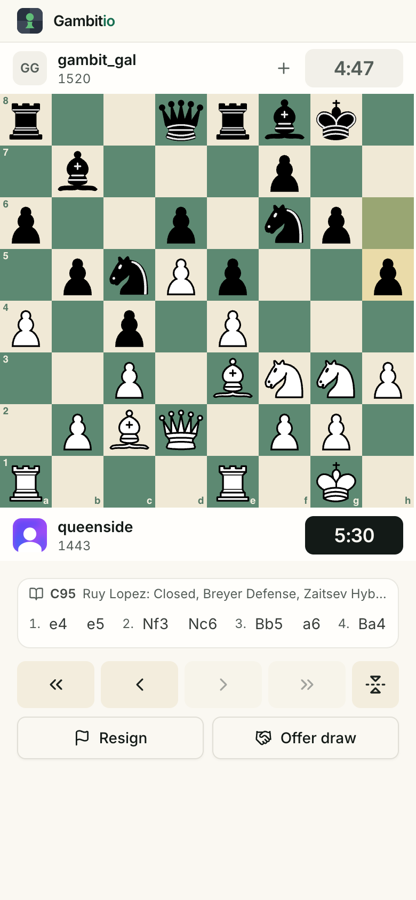
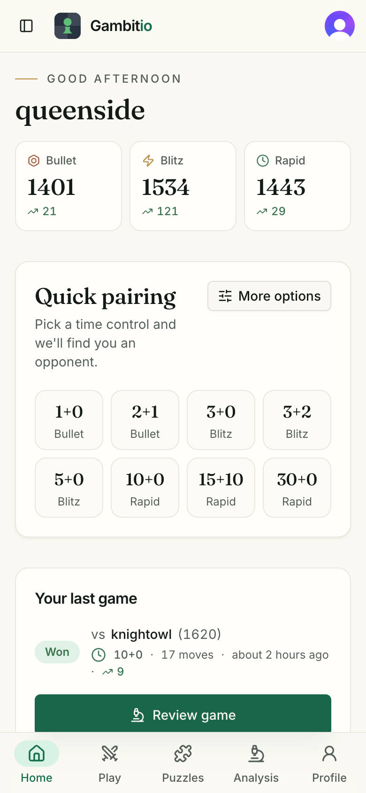

# Gambitio

Real-time online chess: play rated games against people or bots, review them with Stockfish, and train with puzzles, endgame drills and your own opening repertoire. Built with React, TypeScript and WebSockets.

**[Play it live → gambitio.demnamikava.dev](https://gambitio.demnamikava.dev)** · Backend: [gambitio-backend](https://github.com/demna-miqava/gambitio-backend)

<picture>
  <source media="(prefers-color-scheme: dark)" srcset="docs/screenshots/live-game-dark.png">
  
</picture>

## Screenshots

<table>
  <tr>
    <td width="50%"><br><sub><b>Game review</b>: accuracy and mistakes for every move, computed in your browser</sub></td>
    <td width="50%"><br><sub><b>Puzzles</b>: rated training, Puzzle Rush and Survival</sub></td>
  </tr>
  <tr>
    <td width="50%"><br><sub><b>Endgame lab</b>: 45 guided positions against the engine</sub></td>
    <td width="50%"><br><sub><b>Stats</b>: rating history, rank and results per time control</sub></td>
  </tr>
  <tr>
    <td width="50%"><br><sub><b>Home</b>: quick pairing, recent games and the last 30 days at a glance</sub></td>
    <td width="50%" align="center">&nbsp;<br><sub><b>Mobile</b>: the whole app works on a phone</sub></td>
  </tr>
</table>

## Features

### Play

- **Real-time multiplayer** over WebSockets, with the server validating every move and running the clocks
- **Quick pairing** for bullet, blitz and rapid, or a custom game and direct challenges to friends
- **Bots** from 300 to 2400 rating, for unrated practice
- **Series**: play a set of games against a friend with a running score
- **Watch** live games of other players
- Draw offers, resignation, rematches, premoves and sound effects
- **Chat** with your opponent during a game (private to the two players)
- **Focus mode**: just the board, the clocks and the game actions
- Board and gameplay settings one tap away during a game

### Analyze

- **Game review**: accuracy, inaccuracies, mistakes and blunders for every move, with an evaluation graph and the best move at each step
- **Analysis board** with Stockfish running in a web worker, an evaluation bar and multiple engine lines
- **Opening names** for every game
- **Import a game** from a PGN to analyze games played elsewhere
- **Study rooms**: a shared analysis board where friends add variations and comments together in real time

### Train

- **Puzzles**: rated puzzles at your level, Puzzle Rush (as many as you can in 3 minutes) and Survival (three lives)
- **Endgame lab**: 45 positions, from basic mates to pawn endgames, each with a clear goal, played against the engine at full strength
- **Opening repertoire**: save lines from the analysis board, practise them with spaced repetition and see where your games leave your preparation

### Profile and social

- Bullet, blitz, rapid and puzzle ratings, with rating history, rank and results
- Full game history
- Leaderboards per time control
- Friends, online status and real-time notifications for challenges and friend requests
- **Push notifications** for challenges, friend requests and game starts when the tab is in the background
- Privacy settings: who can challenge you and who can chat with you
- Light and dark themes, responsive layout and keyboard-accessible controls

### Upcoming

- **Tournaments**

## Tech Stack

- **React 19** - UI framework
- **TypeScript** - Type safety
- **Vite** - Build tool and dev server
- **Tailwind CSS** - Styling with custom theme system
- **shadcn/ui** - UI component library
- **React Router** - Client-side routing
- **TanStack Query** - Server state management
- **React Hook Form** - Form handling
- **Zod** - Schema validation
- **Clerk** - Authentication
- **Chessground** - Interactive chessboard
- **Chess.js** - Chess logic and validation
- **Stockfish** - Engine analysis in a web worker
- **WebSockets** - Real-time communication
- **Axios** - HTTP client

## Getting Started

### Prerequisites

- Node.js (v18 or higher)
- npm or yarn
- A running [backend server](https://github.com/demna-miqava/gambitio-backend)
- A [Clerk](https://clerk.com) application for sign-in

### Installation

1. Clone the repository:

```bash
git clone https://github.com/demna-miqava/gambitio-frontend.git
cd gambitio-frontend
```

2. Install dependencies:

```bash
npm install
```

3. Set up environment variables:

```bash
cp .env.example .env
```

4. Edit `.env` and configure your environment variables:

```env
# API Configuration
VITE_API_BASE_URL=http://localhost:8080/api
VITE_WS_BASE_URL=http://localhost:8080/api/ws
VITE_CLERK_PUBLISHABLE_KEY=pk_test_...
VITE_STOCKFISH_URL=/stockfish-17.1-lite-single-03e3232.js

# Sound URLs (optional - update with your hosted sound files)
VITE_MOVE_SOUND_URL=https://example.com/sounds/move.mp3
VITE_CAPTURE_SOUND_URL=https://example.com/sounds/capture.mp3
VITE_GENERIC_SOUND_URL=https://example.com/sounds/generic.mp3
```

### Environment Variables

| Variable                     | Description                     | Example                                   |
| ---------------------------- | ------------------------------- | ----------------------------------------- |
| `VITE_API_BASE_URL`          | Backend API base URL            | `http://localhost:8080/api`               |
| `VITE_WS_BASE_URL`           | WebSocket server URL            | `http://localhost:8080/api/ws`            |
| `VITE_CLERK_PUBLISHABLE_KEY` | Clerk publishable key           | `pk_test_...`                             |
| `VITE_STOCKFISH_URL`         | Stockfish script in `public/`   | `/stockfish-17.1-lite-single-03e3232.js`  |
| `VITE_MOVE_SOUND_URL`        | URL for move sound effect       | `https://example.com/sounds/move.mp3`     |
| `VITE_CAPTURE_SOUND_URL`     | URL for capture sound effect    | `https://example.com/sounds/capture.mp3`  |
| `VITE_GENERIC_SOUND_URL`     | URL for generic sound effect    | `https://example.com/sounds/generic.mp3`  |

### Development

Start the development server:

```bash
npm run dev
```

The application will be available at `http://localhost:5173`

### Building for Production

Build the application:

```bash
npm run build
```

Preview the production build:

```bash
npm run preview
```

### Linting

Run ESLint:

```bash
npm run lint
```

## Project Structure

```
src/
├── components/          # Reusable UI components
│   └── ui/             # shadcn/ui components
├── features/           # Feature-based modules
│   ├── archive-game/  # Game archive and history
│   ├── auth/          # Authentication
│   ├── create-game/   # Game creation and setup
│   ├── current-game/  # Live game functionality
│   ├── endgames/      # Endgame lab exercises
│   ├── engine-analysis/ # Stockfish analysis & evaluation
│   ├── friends/       # Friend system and interactions
│   ├── game/          # Shared game components
│   ├── game-review/   # Accuracy and move classification
│   ├── game-table/    # Game list and observation
│   ├── import-game/   # PGN import functionality
│   ├── leaderboard/   # Leaderboards per time control
│   ├── matchmaking/   # Match finding logic
│   ├── notifications/ # User notifications
│   ├── openings/      # Opening names
│   ├── play-bots/     # Games against the computer
│   ├── profile/       # User profile management
│   ├── puzzles/       # Chess puzzles and training
│   ├── repertoire/    # Opening repertoire practice
│   ├── series/        # Game series between friends
│   ├── settings/      # User settings
│   ├── stats/         # Statistics and profiles
│   ├── study/         # Shared study rooms
│   └── watch/         # Watching live games
├── hooks/             # Custom React hooks
├── contexts/          # React contexts
├── services/          # API services
├── constants/         # App constants
├── utils/             # Utility functions
└── pages/             # Page components
```

## License

This project is licensed under the GNU General Public License v3.0 (GPL-3.0) - see the [LICENSE](LICENSE) file for details.

This project uses [Chessground](https://github.com/lichess-org/chessground), which is licensed under GPL-3.0. As required by the GPL-3.0 license, this project must also be distributed under GPL-3.0.

## Acknowledgments

- [Chessground](https://github.com/lichess-org/chessground) - Interactive chessboard
- [Chess.js](https://github.com/jhlywa/chess.js) - Chess logic
