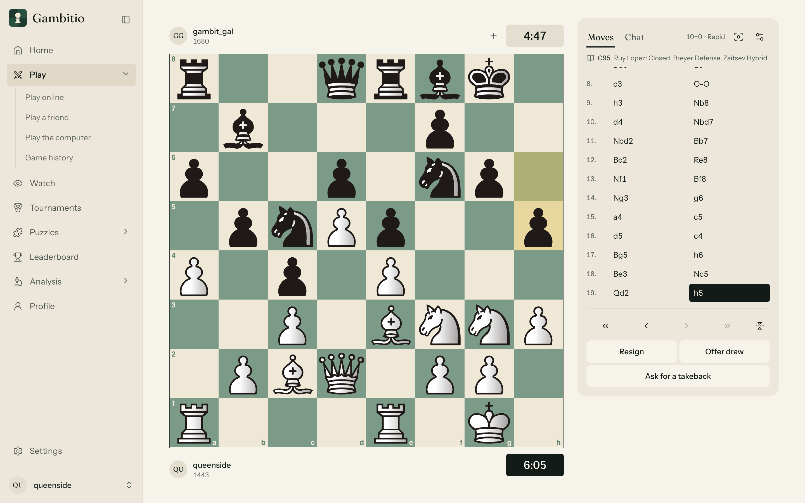
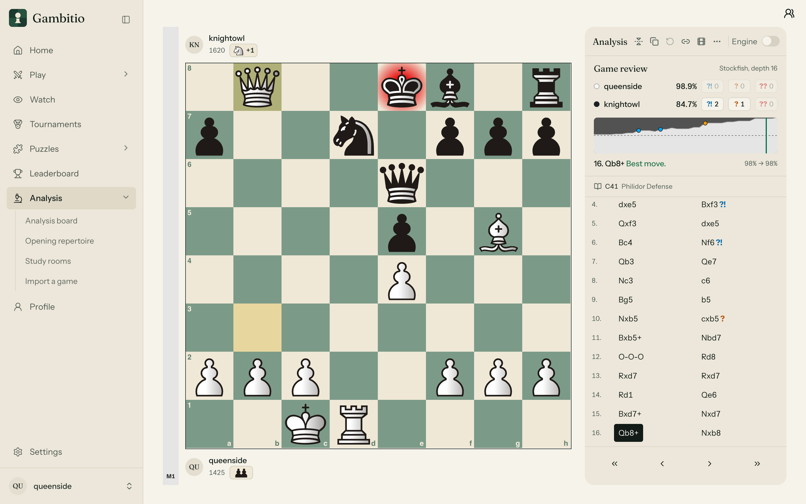
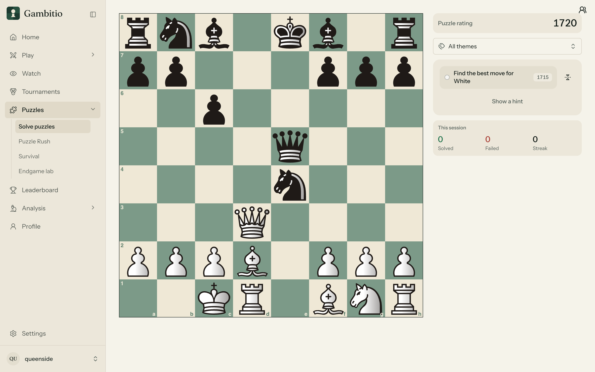
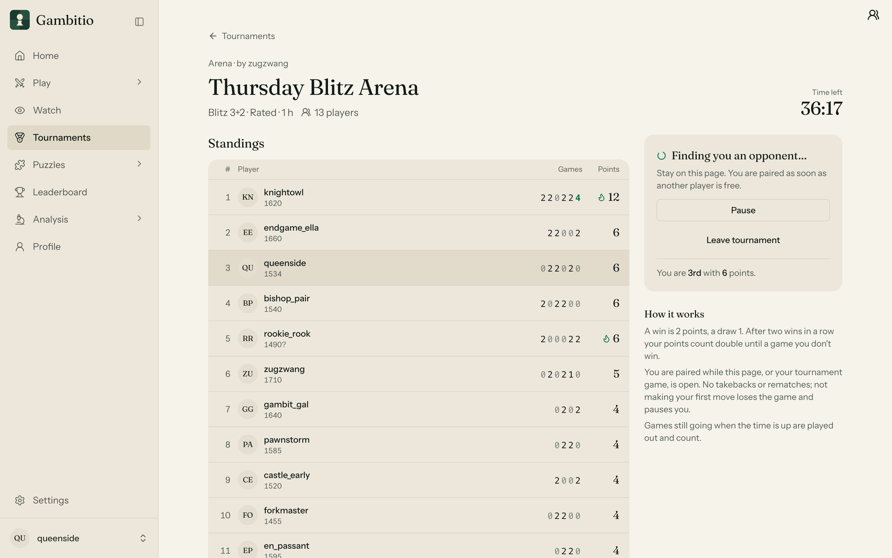
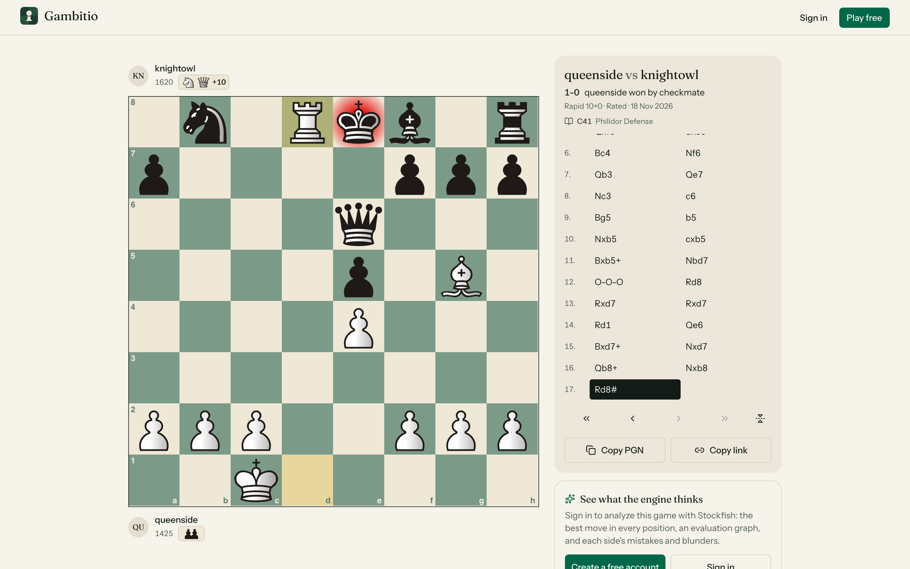
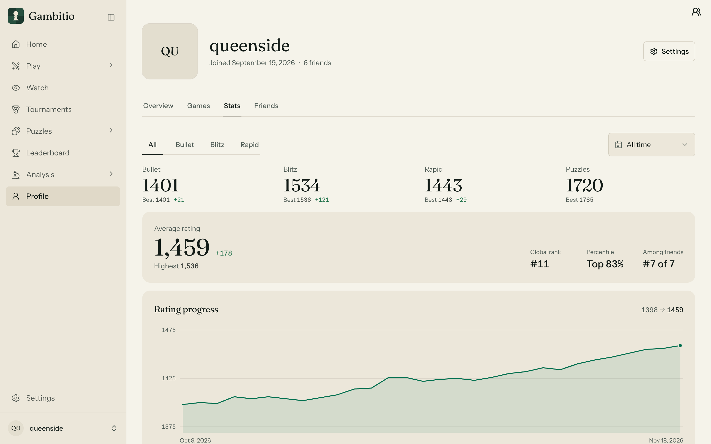

# Gambitio

Real-time online chess: play rated games against people or bots, review them with Stockfish, and train with puzzles, endgame drills and your own opening repertoire. Built with React, TypeScript and WebSockets.

**[Play it live → gambitio.demnamikava.dev](https://gambitio.demnamikava.dev)** · Backend: [gambitio-backend](https://github.com/demna-miqava/gambitio-backend)

<picture>
  <source media="(prefers-color-scheme: dark)" srcset="docs/screenshots/live-game-dark.png">
  
</picture>

## Screenshots

<table>
  <tr>
    <td width="50%"><br><sub><b>Game review</b>: accuracy and mistakes for every move, computed in your browser</sub></td>
    <td width="50%"><br><sub><b>Puzzles</b>: rated training, Puzzle Rush and Survival</sub></td>
  </tr>
  <tr>
    <td width="50%"><br><sub><b>Arena tournaments</b>: live standings, streak bonuses and automatic pairing</sub></td>
    <td width="50%"><br><sub><b>Share links</b>: anyone can replay a game, no account needed</sub></td>
  </tr>
  <tr>
    <td width="50%"><br><sub><b>Endgame lab</b>: 45 guided positions against the engine</sub></td>
    <td width="50%"><br><sub><b>Stats</b>: rating history, rank and results per time control</sub></td>
  </tr>
  <tr>
    <td width="50%"><br><sub><b>Home</b>: quick pairing, your tournament, recent games and the last 30 days</sub></td>
    <td width="50%" align="center">&nbsp;<br><sub><b>Mobile</b>: the whole app works on a phone</sub></td>
  </tr>
</table>

## Features

### Play

- **Real-time multiplayer** over WebSockets, with the server validating every move and running the clocks
- **Quick pairing** for bullet, blitz and rapid, or a custom game and direct challenges to friends
- **Time odds**: challenge a friend with less time on your clock than on theirs, or the other way round (unrated)
- **Bots** from 300 to 2400 rating, for unrated practice, with an instant undo
- **Table mode**: playing at a real board? One phone lying between you is the chess clock (time odds allowed, the far half turned to face your opponent, the screen kept awake) and records the moves; the game is saved, unrated, for review. Play a guest by name or a friend, who confirms the game from their inbox. A clock-only switch hides the board, and a game that couldn't be saved stays on the phone to retry
- **Series**: play a set of games against a friend with a running score
- **Arena tournaments**: create one or join one, get paired again and again while the clock runs, and climb live standings (2 for a win, 1 for a draw, doubled on a streak)
- **Watch** live games of other players, with a **spectator chat** shared by everyone watching (the players never see it, during the game or after); hide it once and it stays hidden, report a message's author from it
- Draw offers, takeback requests, resignation, rematches, premoves and sound effects
- **Player cards**: tap an opponent's avatar for their ratings, your head-to-head record and Add friend
- Material difference beside each clock, and the time an opponent gives you shown under yours
- **Chat** with your opponent during a game (private to the two players)
- **Focus mode** (press Z): just the board, the clocks and the game actions
- Board and gameplay settings one tap away during a game

### Analyze

- **Game review**: accuracy, inaccuracies, mistakes and blunders for every move, with an evaluation graph and the best move at each step
- **Analysis board** with Stockfish running in a web worker, an evaluation bar and multiple engine lines
- **Opening names** for every game
- **Import a game** from a PGN to analyze games played elsewhere
- **Board editor**: set up any position (drag pieces, spare pieces for both colours, tap-to-place on phones, or paste a FEN), with side to move, castling and en passant, checked for legality; open it in the analysis board or play it against the computer (those games aren't saved). The position lives in the URL, so it can be linked
- **Share a game as a GIF**, rendered in your browser with your board and pieces
- **Share a game with a link**: anyone can replay it, no account needed; signed-in players get the engine and the review too. Either player can turn the link off
- **Study rooms**: a shared analysis board where friends add variations and comments together in real time, each with their own optional engine
- **Watch together**: while watching a live game (tournament games too), open a private study room that follows it move by move: the players and clocks, a "Live" button back to the latest move, your own variations and comments, and a room chat. The players can't see or join it until their game is over

### Train

- **Puzzles**: rated puzzles at your level, Puzzle Rush (as many as you can in 3 minutes) and Survival (three lives)
- **Puzzle duel**: invite a friend (from Puzzles or their player card) and race through the same puzzles, easiest first, for 3 minutes by Puzzle Rush rules; you see their score and strikes live, not their board. The server checks every move and keeps the clock; leave and come back, the duel goes on. A result screen opens each puzzle on the analysis board, with a rematch button. No rating
- **Calculate first**: a puzzle mode where you enter the whole line, your moves and the replies you expect, before any piece moves; the line is checked and played out once you submit (three lives, best score kept)
- **Coordinates trainer**: a square's name appears and you click it, as many as you can in 30 seconds, 1 or 2 minutes, from White's or Black's side, with or without pieces; personal bests and recent scores are kept
- **Endgame lab**: 45 positions, from basic mates to pawn endgames, each with a clear goal, played against the engine at full strength
- **Opening repertoire**: save lines from the analysis board, practise them with spaced repetition and see where your games leave your preparation

### Profile and social

- Bullet, blitz, rapid and puzzle ratings, with rating history, rank and results
- **Glicko-2 ratings**: new players reach their level in a handful of games, and a rating that is still settling is marked with a "?"
- Full game history, with filters that combine: result, time control, colour, rated or not, kind (online, tournament, computer, table mode), opponent and dates; a filtered view is a link that survives a reload
- Leaderboards per time control
- Friends, online status and real-time notifications for challenges and friend requests
- **Inbox** in the top corner: add a friend by username and answer waiting challenges and friend requests
- **Push notifications** for challenges, friend requests and game starts when the tab is in the background
- Privacy settings: who can challenge you and who can chat with you
- **Block and report**: a blocked player can't be paired with you, challenge you, befriend you or chat with you, and isn't told; reports (cheating, abusive chat, unsporting play, offensive name) go to the moderators
- **Nine colour palettes** (Emerald, Club green, Midnight, Walnut, Ink, Fjord, Plum, Tide and Olive), each with a light and a dark side
- Merida pieces, a responsive layout and keyboard-accessible controls

### Upcoming

- **Swiss tournaments**, and reminders before a tournament starts

## Tech Stack

- **React 19** - UI framework
- **TypeScript** - Type safety
- **Vite** - Build tool and dev server
- **Tailwind CSS** - Styling with custom theme system
- **shadcn/ui** - UI component library
- **React Router** - Client-side routing
- **TanStack Query** - Server state management
- **React Hook Form** - Form handling
- **Zod** - Schema validation
- **Clerk** - Authentication
- **Chessground** - Interactive chessboard
- **Chess.js** - Chess logic and validation
- **Stockfish** - Engine analysis in a web worker
- **WebSockets** - Real-time communication
- **Axios** - HTTP client

## Getting Started

### Prerequisites

- Node.js (v18 or higher)
- npm or yarn
- A running [backend server](https://github.com/demna-miqava/gambitio-backend)
- A [Clerk](https://clerk.com) application for sign-in

### Installation

1. Clone the repository:

```bash
git clone https://github.com/demna-miqava/gambitio-frontend.git
cd gambitio-frontend
```

2. Install dependencies:

```bash
npm install
```

3. Set up environment variables:

```bash
cp .env.example .env
```

4. Edit `.env` and configure your environment variables:

```env
# API Configuration
VITE_API_BASE_URL=http://localhost:8080/api
VITE_WS_BASE_URL=http://localhost:8080/api/ws
VITE_CLERK_PUBLISHABLE_KEY=pk_test_...
VITE_STOCKFISH_URL=/stockfish-17.1-lite-single-03e3232.js
```

### Environment Variables

| Variable                     | Description                     | Example                                   |
| ---------------------------- | ------------------------------- | ----------------------------------------- |
| `VITE_API_BASE_URL`          | Backend API base URL            | `http://localhost:8080/api`               |
| `VITE_WS_BASE_URL`           | WebSocket server URL            | `http://localhost:8080/api/ws`            |
| `VITE_CLERK_PUBLISHABLE_KEY` | Clerk publishable key           | `pk_test_...`                             |
| `VITE_STOCKFISH_URL`         | Stockfish script in `public/`   | `/stockfish-17.1-lite-single-03e3232.js`  |

### Development

Start the development server:

```bash
npm run dev
```

The application will be available at `http://localhost:5173`

### Building for Production

Build the application:

```bash
npm run build
```

Preview the production build:

```bash
npm run preview
```

### Linting

Run ESLint:

```bash
npm run lint
```

## Project Structure

```
src/
├── components/          # Reusable UI components
│   └── ui/             # shadcn/ui components
├── features/           # Feature-based modules
│   ├── archive-game/  # Game archive and history
│   ├── auth/          # Authentication
│   ├── create-game/   # Game creation and setup
│   ├── current-game/  # Live game functionality
│   ├── endgames/      # Endgame lab exercises
│   ├── engine-analysis/ # Stockfish analysis & evaluation
│   ├── friends/       # Friend system and interactions
│   ├── game/          # Shared game components
│   ├── game-chat/     # Chat between the two players of a game
│   ├── game-review/   # Accuracy and move classification
│   ├── game-table/    # Game list and observation
│   ├── game-tools/    # Focus mode and in-game settings
│   ├── import-game/   # PGN import functionality
│   ├── leaderboard/   # Leaderboards per time control
│   ├── matchmaking/   # Match finding logic
│   ├── moderation/    # Blocking and reporting players
│   ├── notifications/ # User notifications
│   ├── openings/      # Opening names
│   ├── play-bots/     # Games against the computer
│   ├── profile/       # User profile management
│   ├── push/          # Web push notifications
│   ├── puzzles/       # Chess puzzles and training
│   ├── repertoire/    # Opening repertoire practice
│   ├── series/        # Game series between friends
│   ├── share-gif/     # Game GIFs rendered in the browser
│   ├── shared-game/   # Share links and the public game page
│   ├── settings/      # User settings
│   ├── stats/         # Statistics and profiles
│   ├── study/         # Shared study rooms
│   ├── tournaments/   # Arena tournaments: list, lobby, live standings
│   └── watch/         # Watching live games
├── hooks/             # Custom React hooks
├── contexts/          # React contexts
├── services/          # API services
├── constants/         # App constants
├── utils/             # Utility functions
└── pages/             # Page components
```

## License

This project is licensed under the GNU General Public License v3.0 (GPL-3.0) - see the [LICENSE](LICENSE) file for details.

This project uses [Chessground](https://github.com/lichess-org/chessground), which is licensed under GPL-3.0. As required by the GPL-3.0 license, this project must also be distributed under GPL-3.0.

## Acknowledgments

- [Chessground](https://github.com/lichess-org/chessground) - Interactive chessboard
- [Chess.js](https://github.com/jhlywa/chess.js) - Chess logic
